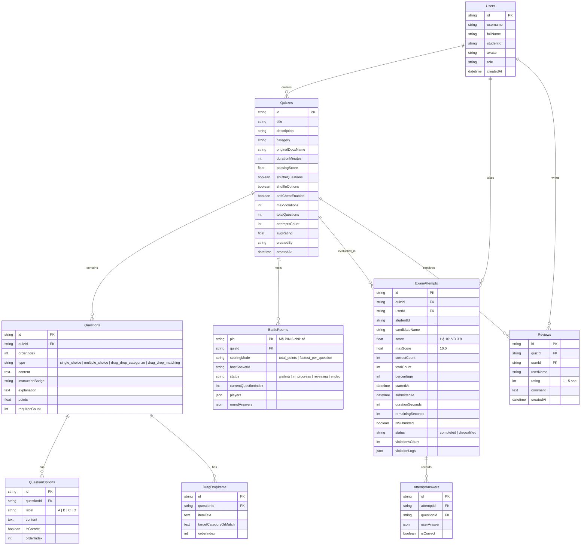

# NỀN TẢNG THI TRẮC NGHIỆM TRỰC TUYẾN & THI ĐẤU THỜI GIAN THỰC
### (Online Quiz & Real-time Battle Platform)

> **Kiến trúc:** Senior Full-Stack Architect & Lead Developer  
> **Phiên bản:** 1.0.0 Production Ready  
> **Ngôn ngữ & Runtimes:** React 18, Tailwind CSS, Node.js (ES Modules), Express, Socket.IO, OpenXML Parser, XLSX  

---

## 🌟 1. TỔNG QUAN HỆ THỐNG & ĐẶC TẢ NGHIỆP VỤ

Hệ thống được thiết kế và lập trình trọn vẹn theo đúng 100% các yêu cầu nghiệp vụ và đặc tả giao diện khắt khe của một nền tảng Khảo thí Điện tử chuẩn Đại học kết hợp Đấu trường Trực tuyến Thời gian thực (Real-time Multiplayer Battle).

```
┌────────────────────────────────────────────────────────────────────────┐
│                        HỆ SINH THÁI ỨNG DỤNG                           │
├───────────────────────────────────┬────────────────────────────────────┤
│  MÀN HÌNH LÀM BÀI CHUẨN KHẢO THÍ  │     ĐẤU TRƯỜNG THI ĐẤU MULTIPLAYER │
│  - Đường viền cảnh báo sọc đỏ-trắng│  - Mã phòng PIN 6 số & Quét mã QR  │
│  - Avatar, MSSV: dtc245200060     │  - Chế độ 1: Tính tổng điểm tốc độ │
│  - Đồng hồ LED đếm ngược kỹ thuật số│  - Chế độ 2: Nhanh nhất từng câu   │
│  - Nút "NỘP BÀI" xanh lá nổi bật  │  - Podium vinh danh 1, 2, 3        │
├───────────────────────────────────┼────────────────────────────────────┤
│       4 DẠNG CÂU HỎI TƯƠNG TÁC    │      BÓC TÁCH WORD (.DOCX) XML     │
│  1. Single Choice (1 đáp án)      │  - w:color / w:highlight / w:b / w:u│
│  2. Multiple Choice (Ràng buộc đủ)│  - Đỏ, Vàng, Xanh lá, Xanh dương   │
│  3. Kéo thả phân loại vào cột     │  - Nhận diện câu "Câu 1:", "A."... │
│  4. Kéo thả ghép nối phát biểu    │  - Tự động sinh JSON bài thi chuẩn │
└───────────────────────────────────┴────────────────────────────────────┘
```

---

## 🗄️ 2. DATABASE SCHEMA DESIGN

Hệ thống triển khai 9 bảng thực thể liên kết hoàn chỉnh:



---

## 🎯 3. CHI TIẾT TÍNH NĂNG THEO YÊU CẦU ĐẶC TẢ

### 3.1. Màn hình Làm bài thi (Exam Taking Interface)
- **Top Header Bar:**
  - Viền trên cùng có họa tiết sọc chéo đỏ-trắng (`exam-warning-border`) cảnh báo phòng thi chuẩn.
  - Góc trái: Avatar tròn, Họ tên (`Nguyễn Văn An`), Mã sinh viên (`dtc245200060`).
  - Chính giữa: Đồng hồ kỹ thuật số LED (`font-digital`, cỡ lớn hiển thị đếm ngược `MM:SS`, cảnh báo đỏ khi dưới 3 phút).
  - Góc phải: Nút **"NỘP BÀI"** màu xanh lá nổi bật kèm icon máy bay giấy.
- **Khung Câu hỏi Chính (Main Question Card):**
  - Khung card trắng bo góc tròn, đổ bóng nhẹ trên nền xám `#f4f6f9`.
  - Góc phải trên: Checkbox **"Xem lại câu này"** (Mark for review) có icon cờ vàng.
  - Tiêu đề câu: In đậm `Câu <số>:`, kèm badge chỉ dẫn màu đỏ/cam nhạt (VD: `(!) Sinh viên chọn 3 phương án đúng nhất`).
  - Hỗ trợ 4 loại câu hỏi:
    1. **Single Choice:** Dạng lưới 2 cột hoặc 1 cột, viền đổi màu xanh dương đậm và nền xanh nhạt khi chọn.
    2. **Multiple Choice:** Ràng buộc logic nghiêm ngặt: Phải chọn **đúng số lượng yêu cầu** mới tính là hoàn thành câu.
    3. **Drag & Drop Categorization:** Thẻ từ khóa nền xanh nhạt bên trên, 2+ cột bên dưới có vùng thả viền nét đứt.
    4. **Drag & Drop Matching:** Thẻ đáp án bên trên, các hàng mệnh đề cố định bên trái, ô trống nét đứt bên phải để thả thẻ.
    *(Đặc biệt hỗ trợ cả chuột trên PC và chạm cảm ứng trên Mobile/Tablet)*.
- **Bottom Footer Bar:**
  - Góc trái: Badge Tên môn học (`CHỦ NGHĨA XÃ HỘI KHOA HỌC - BÀI 5`) + link dự phòng (`⚡ Web chậm? Dùng link dự phòng`).
  - Chính giữa: Thanh phân trang số câu tròn:
    - Trắng viền xám (chưa làm).
    - Xanh dương đậm (câu đang mở).
    - Xanh nhạt (đã trả lời).
    - Chấm vàng (đánh dấu xem lại).
    - Nút `«` (Về đầu) và `»` (Về cuối).
    - Nút "Câu hỏi tiếp theo" / "Nộp bài".

### 3.2. Logic Ràng buộc Nộp bài & Chấm điểm
- **Kiểm tra trước khi nộp:**
  - Nếu còn câu chưa làm hoặc câu chọn nhiều đáp án chưa đủ số lượng: Hiện modal cảnh báo **"Chưa làm xong"** (nêu rõ số câu thiếu, liệt kê các nút số màu đỏ để bấm nhảy tới ngay và nút **"Làm câu X"**).
  - Nếu đã làm đủ: Hiện modal xác nhận **"Nộp bài?"** (`Bạn đã làm đủ X/X câu. Nộp rồi sẽ không sửa được nữa.`).
- **Màn hình Kết quả & Xem lại:**
  - Hiển thị Điểm số hệ 10 cỡ lớn (VD: `3.9 điểm / 10`), thống kê `Đúng 11 / 28 câu (39%)`.
  - Nút điều hướng nhanh: `Làm lại`, `Trang quiz`, `Quiz khác`.
  - Khung Đánh giá 1-5 sao kèm ô nhận xét.
  - Xem lại chi tiết: Đáp án đúng tô nền xanh lá + viền xanh lá + `✓`; đáp án thí sinh chọn sai tô nền đỏ nhạt + viền đỏ + `✕`.
  - Nút **"💡 Giải thích chi tiết"** mở Trợ lý AI phân tích cơ sở lý luận theo giáo trình chuẩn.

### 3.3. Module Bóc tách File Word (.docx) Chuẩn Xác
- Tự động bóc tách từ tầng XML gốc OpenXML (`word/document.xml`).
- Xử lý các thẻ định dạng:
  - `<w:color w:val="FF0000|..."/>`: Màu chữ (Đỏ, Vàng, Xanh lá, Xanh dương, mã Hex tùy chỉnh).
  - `<w:highlight w:val="yellow|..."/>`: Màu nền đánh dấu highlight.
  - `<w:b/>`: Chữ in đậm.
  - `<w:u/>`: Chữ gạch chân.
- Cho phép người dùng tùy chọn phối hợp nhiều điều kiện nhận diện đáp án cùng lúc trên giao diện trước khi lưu.

### 3.4. Đấu Trường Thời Gian Thực (Multiplayer Battle)
- Vào phòng bằng mã PIN 6 số hoặc quét mã QR (không yêu cầu đăng nhập).
- Chủ phòng tùy biến 2 chế độ chấm điểm:
  1. *Tính tổng điểm:* Mỗi câu đúng được 500-1000 điểm tùy tốc độ trả lời; hết trận vinh danh Top 1, 2, 3.
  2. *Nhanh nhất từng câu:* Sau mỗi câu công bố ngay kỷ lục người trả lời đúng và nhanh nhất.
- Bục vinh danh Podium (🥇 Vàng, 🥈 Bạc, 🥉 Đồng) kèm hiệu ứng pháo hoa Confetti rực rỡ.

### 3.5. Chống Gian Lận (Proctoring) & Crash Recovery
- Tự động bật Fullscreen khi bắt đầu bài kiểm tra có tính giờ.
- Giám sát sự kiện `visibilitychange`, `window.blur`, thoát Fullscreen, mở DevTools. Tự động thu bài nếu vi phạm quá $N$ lần.
- Xáo trộn thứ tự câu hỏi và xáo trộn đáp án A, B, C, D độc lập cho từng thí sinh.
- Tự động lưu LocalStorage và đồng bộ ngầm lên Server mỗi 15 giây hoặc khi chọn đáp án; F5 hay mất mạng vẫn giữ nguyên trạng thái.

### 3.6. Thống Kê & Báo Cáo Khảo Thí
- Biểu đồ phổ điểm hệ 10 trực quan.
- Bảng ma trận tỷ lệ làm sai ở từng câu hỏi xếp theo độ khó giảm dần.
- Xuất bảng điểm chi tiết ra file **Excel (.xlsx)** gồm 3 sheet: Bảng điểm thí sinh, Phân tích câu hỏi, Tổng quan thống kê.
- Hỗ trợ in báo cáo khảo thí / PDF trực tiếp.

---

## 🚀 4. HƯỚNG DẪN CÀI ĐẶT & CHẠY ỨNG DỤNG

### Cách 1: Chạy trực tiếp trên máy chủ / Localhost

#### Bước 1: Khởi động Backend (Port 5000)
```bash
cd backend
npm install
npm start
```
*Backend chạy tại `http://localhost:5000` (đồng thời phục vụ toàn bộ Frontend build sẵn).*

#### Bước 2: Chạy Frontend ở chế độ Hot-Reload Dev (Tùy chọn cho lập trình viên)
```bash
cd frontend
npm install
npm run dev
```
*Frontend chạy tại `http://localhost:3000` (đã cấu hình Proxy tự động chuyển tiếp API & Socket sang Port 5000).*

---

### Cách 2: Đóng gói và chạy bằng Docker Compose (Khuyên Dùng)

Chỉ với 1 câu lệnh duy nhất:
```bash
docker compose up --build
```
- **Frontend Container:** Phục vụ qua Nginx tối ưu hóa cao tại cổng `http://localhost:80` hoặc `http://localhost:3000`.
- **Backend Container:** Node.js Alpine chạy tại cổng `http://localhost:5000`.

---

## 🧪 5. DỮ LIỆU KIỂM THỬ MẪU (TEST DATA)
Hệ thống đã chuẩn bị sẵn:
1. **Bài thi mẫu chuẩn:** `CHỦ NGHĨA XÃ HỘI KHOA HỌC - BÀI 5` (có đủ 4 dạng câu hỏi: 1 đáp án, nhiều đáp án ràng buộc 3 lựa chọn, kéo thả phân loại vào 2 cột điều kiện khách quan/chủ quan, và kéo thả ghép nối phát biểu tác phẩm kinh điển).
2. **File Word (.docx) mẫu:** Đặt tại thư mục `sample-files/DeThiMau_CNXHKH.docx` để người dùng test ngay tính năng tải file Word.
3. **Thí sinh mặc định:** `Nguyễn Văn An` - Mã định danh: `dtc245200060`.
4. **Script kiểm thử tự động:** `npm run test:docx` để kiểm chứng bộ bóc tách XML độc lập.

